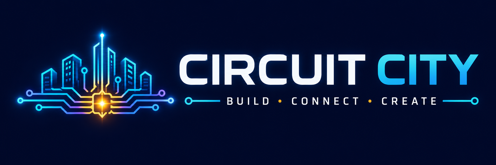
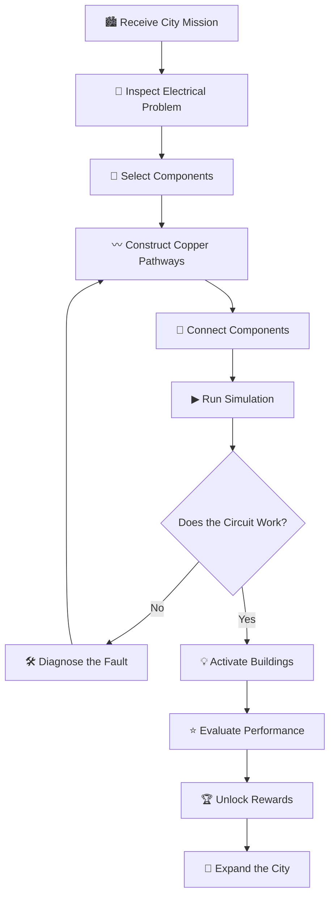
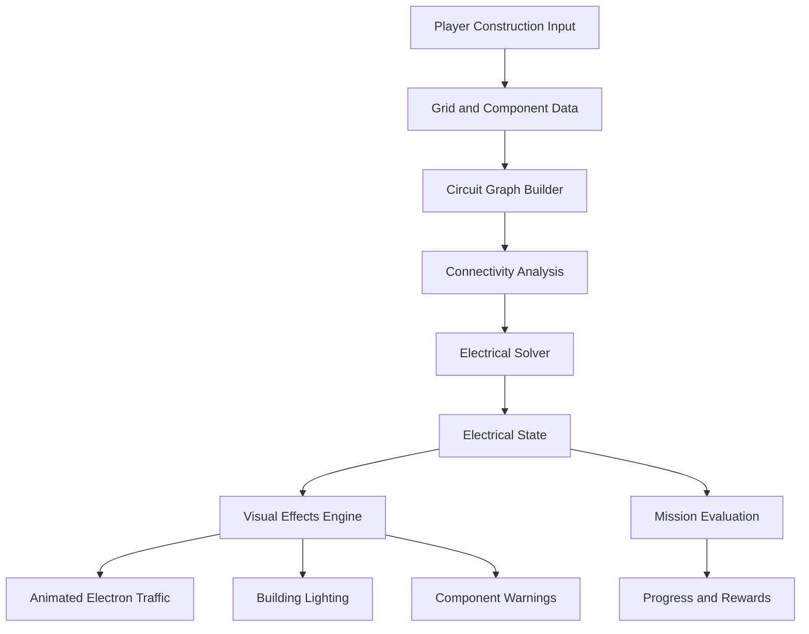
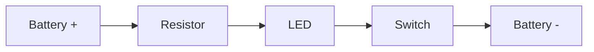
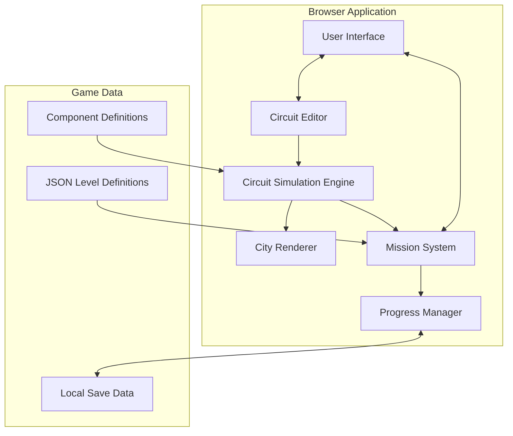
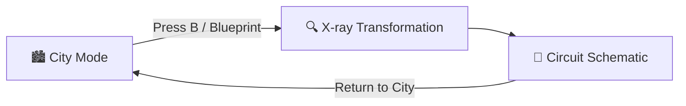
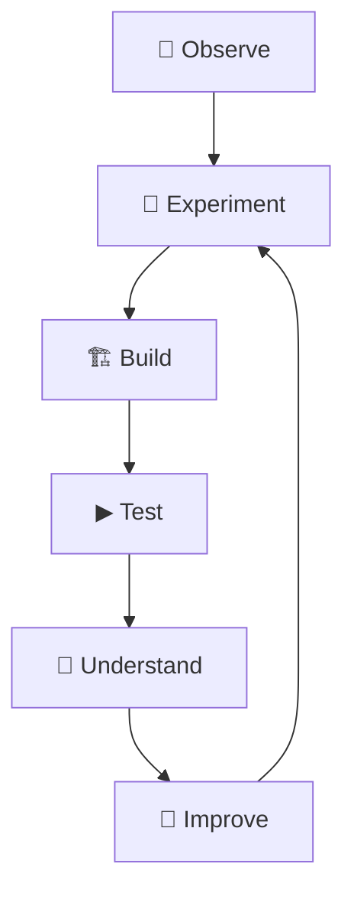
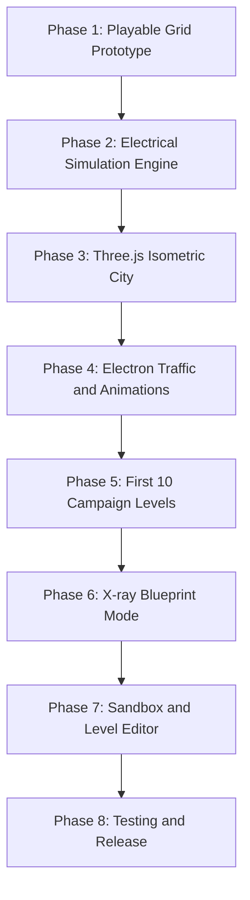

 
# ⚡ CIRCUIT CITY
### Build It. Connect It. Power It.

<p align="center">
  <strong>An electrical engineering city-building adventure.</strong><br/>
  Turn a giant motherboard into a living, breathing smart city — one circuit at a time.
</p>

<p align="center">
  <em>Educational Puzzle Builder · Electronics Simulator · STEM Game · Creative Sandbox</em>
</p>



---

## 📖 Table of Contents

1. [Project Overview](#-1-project-overview)
2. [The World of Circuit Board City](#-2-the-world-of-circuit-board-city)
3. [Core Gameplay](#-3-core-gameplay)
4. [Electronic Components as City Infrastructure](#-4-electronic-components-as-city-infrastructure)
5. [Electrical Simulation Architecture](#-5-electrical-simulation-architecture)
6. [Technical System Design](#-6-technical-system-design)
7. [Campaign and Mission Design](#-7-campaign-and-mission-design)
8. [User Interface and Blueprint Mode](#-8-user-interface-and-blueprint-mode)
9. [Learning System and Educational Design](#-9-learning-system-and-educational-design)
10. [Development Roadmap](#-10-development-roadmap)
11. [Getting Started](#-getting-started)
12. [Safety, Accuracy and Design Principles](#-11-safety-accuracy-and-design-principles)
13. [Contributing](#-12-contributing)

---

# ⚡ 1. Project Overview

**Circuit Board City** is an educational engineering game in which players become electrical engineers, city planners, and problem-solvers.

The entire game takes place on an enormous futuristic motherboard.

Instead of constructing ordinary roads for cars, players build copper electrical pathways. Instead of placing ordinary buildings, they construct electronic components. Instead of managing conventional city traffic, they observe animated representations of electrical charge moving through their circuits.

The ultimate objective is to transform a dark, inactive motherboard into a fully operational smart city.

Every successful electrical connection brings another part of the city to life.

## The central idea

Circuit Board City combines three interconnected experiences:

| Experience | Purpose |
|---|---|
| City builder | Construct and expand a futuristic electronic metropolis |
| Engineering simulator | Build and experiment with electrical circuits |
| Puzzle adventure | Complete missions, diagnose faults and unlock districts |

The game is designed primarily for learners aged **13–16**, with the possibility of adapting its explanations and challenges for other age groups.

## The design philosophy

The central design principle is:

> The player should learn electronics by building a city that actually behaves like an electrical circuit.

This means the visual world and the electrical simulation must work together.

A building should not illuminate simply because a decorative animation plays. Its behavior should be driven by the electrical state calculated by the simulation system.

Likewise, a broken wire should have a meaningful consequence: the electrical pathway becomes incomplete, current stops, and the affected buildings lose power.

## Core game pillars

- **BUILD:** Construct electrical networks using copper traces and electronic components.
- **EXPERIMENT:** Change component values and observe electrical behavior.
- **DISCOVER:** Unlock new electronics, districts and engineering concepts.
- **SOLVE:** Diagnose faults and repair damaged infrastructure.
- **CREATE:** Design original electronic cities in an unrestricted sandbox.

---

# 🌆 2. The World of Circuit Board City

## A city built on a motherboard

The game world is a giant green circuit board containing copper pathways, silver connection pads, electronic components, microchips and glowing energy channels.

The motherboard is divided into districts, each introducing a new level of electrical engineering.

The city begins dark.

As the player restores electrical systems, the environment gradually transforms:

- Houses illuminate.
- Streetlights activate.
- Factories begin operating.
- Digital billboards turn on.
- Transportation systems become operational.
- Automated infrastructure becomes available.
- Entire districts become accessible.

The city becomes a visual record of the player's engineering progress.

## The four main worlds

### WORLD 01 — THE SUBURBS

**Levels 1–10 · Basic electrical circuits**

<details>
<summary>World concept and learning objectives</summary>

The player arrives in a quiet suburban neighborhood after a citywide blackout.

The mayor needs an engineer to reconnect the power station to the houses.

The player learns:

- Battery terminals.
- Positive and negative connections.
- Copper wires.
- Complete and incomplete circuits.
- Open and closed switches.
- LEDs and polarity.
- Resistance.
- Basic troubleshooting.
- Simple series and parallel connections.

**World finale:** The Great Suburban Blackout.

The player must diagnose several electrical faults and restore power to the entire neighborhood.

</details>

### WORLD 02 — DOWNTOWN RUSH HOUR

**Levels 11–20 · Series and parallel circuits**

<details>
<summary>World concept and learning objectives</summary>

The player unlocks a busy downtown district containing skyscrapers, shopping centers, offices and transportation infrastructure.

The electrical networks become larger and more complicated.

Players learn:

- Series circuits.
- Parallel circuits.
- Multiple electrical loads.
- Branches and junctions.
- Voltage distribution.
- Independent power pathways.
- Electrical network reliability.

**World finale:** Rush Hour Blackout.

A damaged connection threatens the downtown district. The player must redesign the network so that essential buildings remain powered.

</details>

### WORLD 03 — THE INDUSTRIAL ZONE

**Levels 21–30 · Resistance, current and electrical power**

<details>
<summary>World concept and learning objectives</summary>

The industrial district contains factories, machinery, production lines, motors and large power stations.

Electrical safety becomes increasingly important.

Players learn:

- Voltage.
- Current.
- Resistance.
- Ohm's law.
- Electrical power.
- Component ratings.
- Voltage drops.
- Short circuits.
- Overloaded electrical systems.

**World finale:** Protect the Robot Factory.

The player must select suitable components and protect a factory from unsafe operating conditions.

</details>

### WORLD 04 — THE SMART CITY

**Levels 31–40 · Logic and automation**

<details>
<summary>World concept and learning objectives</summary>

The final campaign district is a futuristic automated metropolis.

Buildings make decisions based on electronic signals.

Players unlock:

- Transistors.
- Sensors.
- AND gates.
- OR gates.
- NOT gates.
- Automatic traffic systems.
- Electronic security systems.
- Automated bridges and elevators.

**World finale:** The Automatic Drawbridge.

A bridge opens only when a ship is detected and a second safety condition is satisfied. The player constructs an AND-gate control system to operate the bridge.

</details>

---

# 🏗️ 3. Core Gameplay

## The central gameplay loop

Every mission follows a consistent engineering process.



## Building electrical roads

Players construct copper electrical pathways on a snapping grid.

The basic construction process:

1. Select the wire tool.
2. Select a starting grid position.
3. Drag or click to construct a pathway.
4. Connect the pathway to a component terminal.
5. Complete the return connection.
6. Run the electrical simulation.
7. Observe the result.

The grid should support:

- Straight wire segments.
- Corners.
- Junctions.
- Branches.
- Intersections.
- Broken connections.
- Insulated pathways.
- Positive and negative connections.

The initial prototype is designed around a **12 × 12 grid**. Larger levels can expand to 32 × 32 cells or beyond.

## Electron traffic

Animated electron cars represent electrical charge movement.

| Electrical condition | Visual representation |
|---|---|
| No current | Cars remain stationary |
| Normal current | Cars travel steadily |
| High current | Faster and brighter traffic |
| Open circuit | Cars stop at the break |
| Short circuit | Fuse animation and simulated shutdown |
| Capacitor charging | Energy parking garage fills |
| Capacitor discharging | Stored energy is released |

These cars are a teaching metaphor, not a literal representation of electron motion.

Advanced lessons can explain the difference between electron flow and conventional current direction.

## Power stations

Every level begins with an electrical source.

The initial power station has two terminals:

- Red (+): positive terminal.
- Black (−): negative terminal.

The electrical dashboard can display:

- Supply voltage.
- Circuit current.
- Battery energy.
- Power consumption.
- Circuit status.
- Component warnings.

Later campaign levels introduce solar panels, generators and other power sources.

---

# 🏢 4. Electronic Components as City Infrastructure

The defining feature of Circuit Board City is its conversion of electronic components into recognizable city buildings.

Players learn the purpose of an electronic component by interacting with its city equivalent.

| Electronic component | City equivalent | Educational concept |
|---|---|---|
| Battery | Power station | Voltage and energy supply |
| Wire | Copper highway | Electrical connectivity |
| Resistor | Tollbooth | Resistance and current |
| LED | Light tower | Polarity and light emission |
| Switch | Drawbridge | Open and closed circuits |
| Diode | One-way street | Directional conduction |
| Capacitor | Energy parking garage | Charge storage |
| Transistor | Traffic control tower | Electronic switching |
| Sensor | Detection station | Input signals |
| Motor | Factory machinery | Electrical energy conversion |
| Logic gate | Decision center | Boolean logic |
| Transformer | Voltage station | Voltage conversion |

## Resistor — The Tollbooth

A resistor limits current.

Players can select different resistance values and observe how those values affect the circuit.

A larger resistance generally reduces current in a simple fixed-voltage resistive circuit.

The game uses this building to introduce Ohm's law:

\[
V = IR
\]

Where:

- \(V\) = voltage, measured in volts.
- \(I\) = current, measured in amperes.
- \(R\) = resistance, measured in ohms.

## LED — The Light Tower

An LED illuminates when correctly connected and operated within its electrical limits.

Players learn:

- Anode and cathode.
- Forward bias.
- Reverse bias.
- Current limiting.
- LED operating current.

The player must orient the LED correctly and select a suitable current-limiting resistor.

## Switch — The Drawbridge

The drawbridge controls whether an electrical pathway is connected.

An open switch interrupts the path.

A closed switch completes the connection.

This building introduces the difference between open and closed circuits.

## Diode — The One-Way Street

A diode permits current in its forward direction and blocks it in its reverse direction under the simplified operating model.

Players rotate the building to establish the correct orientation.

## Capacitor — The Energy Parking Garage

A capacitor stores electrical charge and can release it later.

The parking garage metaphor allows players to observe:

- Charging.
- Stored energy.
- Discharging.
- Time-dependent behavior.

The stored energy of an ideal capacitor is:

\[
E = \frac{1}{2}CV^2
\]

Where \(C\) is capacitance and \(V\) is capacitor voltage.

## Transistor — The Traffic Control Tower

A transistor allows a smaller control signal to influence a larger current pathway.

Players use a control input to activate or deactivate major infrastructure.

This introduces electronic switching and the foundations of digital control.

## Logic gates — The Decision Centers

Logic gates allow buildings to make decisions using electrical signals.

For example, an AND gate activates its output only when both inputs are active.

| Input A | Input B | AND output |
|---|---|---|
| 0 | 0 | 0 |
| 0 | 1 | 0 |
| 1 | 0 | 0 |
| 1 | 1 | 1 |

This system becomes essential in the Smart City campaign.

---

# ⚙️ 5. Electrical Simulation Architecture

The simulation is the technical foundation of the game.

Circuit Board City is intended to use an actual electrical model behind the visual city.

The game should not simply animate cars along pathways that look connected. The simulation must determine whether current can flow and what happens to the components.

## Simulation pipeline



## Circuit graph

The electrical network should be represented separately from the city graphics.

A circuit can be represented as a graph:

\[
G = (V,E)
\]

Where:

- \(V\) represents electrical nodes.
- \(E\) represents electrical connections and components.

Example:



This graph represents a simple series circuit.

The graph is the foundation for identifying:

- Connected components.
- Open pathways.
- Branches.
- Loops.
- Component terminals.
- Electrical faults.

## Electrical component models

The planned simulation system should support:

| Component | Model requirement |
|---|---|
| Battery | Voltage source |
| Wire | Low-resistance connection |
| Resistor | Resistive behavior |
| LED | Nonlinear forward-conduction behavior |
| Switch | Open or closed connection |
| Diode | Direction-dependent conduction |
| Capacitor | Time-dependent charge storage |
| Transistor | Signal-controlled conduction |
| Logic gate | Boolean input/output behavior |

## Fundamental equations

### Ohm's law

\[
V = IR
\]

### Electrical power

\[
P = VI
\]

### Resistor power

\[
P = I^2R
\]

### Capacitor energy

\[
E = \frac{1}{2}CV^2
\]

These equations can drive component warnings, dashboard measurements and visual effects.

For example, a 9 V ideal source connected to a 1,000 Ω resistor produces:

\[
I = \frac{9}{1000} = 0.009A
\]

\[
I = 9mA
\]

This is a simplified resistive example, not a complete LED circuit design.

## Solver development

The first playable prototype can begin with basic connectivity checks.

The more advanced simulation should introduce:

1. DC circuit analysis.
2. Series and parallel resistive networks.
3. Kirchhoff's current law.
4. Kirchhoff's voltage law.
5. Component power limits.
6. Short-circuit detection.
7. Diode and LED models.
8. Capacitor charging and discharging.
9. Transistor switching.
10. Fault diagnosis.

An advanced version should use nodal analysis for resistive networks, with appropriate nonlinear device models for semiconductor components.

Capacitor behavior requires time-dependent simulation rather than a purely static circuit calculation.

**Important implementation distinction:** A grid connectivity checker is not a complete electrical solver. The prototype and the advanced solver must be treated as separate engineering milestones.

---

# 🧠 6. Technical System Design

## Proposed technology stack

The original game blueprint recommends a browser-based implementation.

| Layer | Proposed technology | Responsibility |
|---|---|---|
| Application | HTML, CSS, JavaScript | Core application |
| UI | JavaScript interface components | Menus, dashboards and controls |
| 3D graphics | Three.js | Isometric city and visual environment |
| Circuit engine | Custom JavaScript | Electrical calculations |
| Level storage | JSON | Mission definitions |
| Persistence | Browser storage initially | Local progress |
| Hosting | Static web hosting | Browser distribution |
| Backend | Optional future service | Accounts and shared content |

The first version should remain playable without requiring a complex backend.

## High-level architecture



## Separation of concerns

The game should avoid combining rendering, simulation and mission logic into one tightly coupled system.

Each major system should have a defined responsibility.

### City renderer

Responsible for:

- Rendering the motherboard.
- Displaying buildings.
- Drawing copper traces.
- Showing lighting and animation.
- Managing camera movement.
- Presenting city state.

### Circuit editor

Responsible for:

- Component placement.
- Wire drawing.
- Grid snapping.
- Terminal connections.
- Rotation.
- Deletion.
- Editing component properties.

### Circuit engine

Responsible for:

- Circuit graph construction.
- Connectivity analysis.
- Electrical calculations.
- Component state.
- Fault detection.
- Simulation output.

### Mission system

Responsible for:

- Objectives.
- Level configuration.
- Completion conditions.
- Hints.
- Scoring.
- Unlocks.

### Progress manager

Responsible for:

- Completed levels.
- Stars.
- Electrical credits.
- Unlocked components.
- Saved city layouts.

## Suggested project structure

The following is a proposed organization for the full implementation. It is an architectural recommendation, not a claim that every module already exists.

```text
circuit-board-city/
│
├── public/
│   ├── assets/
│   │   ├── buildings/
│   │   ├── components/
│   │   ├── characters/
│   │   ├── textures/
│   │   └── audio/
│   │
│   └── icons/
│
├── src/
│   ├── app/
│   │   ├── App.js
│   │   ├── router.js
│   │   └── settings.js
│   │
│   ├── city/
│   │   ├── CityRenderer.js
│   │   ├── Grid.js
│   │   ├── Camera.js
│   │   ├── Buildings.js
│   │   └── Lighting.js
│   │
│   ├── editor/
│   │   ├── CircuitEditor.js
│   │   ├── WireTool.js
│   │   ├── PlacementTool.js
│   │   ├── SelectionTool.js
│   │   └── BlueprintMode.js
│   │
│   ├── electronics/
│   │   ├── CircuitGraph.js
│   │   ├── CircuitSolver.js
│   │   ├── Connectivity.js
│   │   ├── Components.js
│   │   ├── OhmsLaw.js
│   │   └── FaultDetection.js
│   │
│   ├── missions/
│   │   ├── MissionManager.js
│   │   ├── Objectives.js
│   │   ├── Scoring.js
│   │   └── Levels.js
│   │
│   ├── progression/
│   │   ├── Rewards.js
│   │   ├── Unlocks.js
│   │   └── SaveManager.js
│   │
│   ├── interface/
│   │   ├── Dashboard.js
│   │   ├── Toolbox.js
│   │   ├── MissionPanel.js
│   │   └── Menus.js
│   │
│   └── main.js
│
├── data/
│   ├── components.json
│   ├── worlds.json
│   └── levels/
│
├── tests/
│   ├── circuit/
│   ├── components/
│   └── missions/
│
├── README.md
└── package.json
```

## Example level definition

A JSON-based level system allows new missions to be added without rewriting the entire application.

```json
{
  "id": "suburbs-01",
  "world": "the-suburbs",
  "level": 1,
  "title": "Bring the Lights Back",
  "difficulty": "beginner",
  "grid": {
    "width": 12,
    "height": 12
  },
  "objective": {
    "type": "complete-circuit",
    "description": "Connect the battery to the LED."
  },
  "availableComponents": [
    "battery",
    "wire",
    "led"
  ],
  "learningObjectives": [
    "Identify battery terminals",
    "Understand electrical connections",
    "Complete a simple circuit"
  ],
  "reward": {
    "credits": 100,
    "stars": 3
  }
}
```

---

# 🎮 7. Campaign and Mission Design

The first campaign consists of 40 planned levels across four worlds.

## World 1 mission list

| Level | Mission | Main learning objective |
|---:|---|---|
| 01 | Bring the Lights Back | Basic circuit |
| 02 | The Broken Connection | Open circuits |
| 03 | The Drawbridge Switch | Switching |
| 04 | Double the Neighborhood | Multiple loads |
| 05 | The LED Emergency | Polarity |
| 06 | The Tollbooth | Resistance |
| 07 | Electrical Detectives | Troubleshooting |
| 08 | Neighborhood Expansion | Circuit planning |
| 09 | Power Five Houses | Parallel networks |
| 10 | The Great Suburban Blackout | Combined skills |

## Mission scoring

Every mission can award up to three stars.

| Stars | Requirement |
|---|---|
| ⭐ | Complete the circuit successfully |
| ⭐⭐ | Complete it without unsafe component operating conditions |
| ⭐⭐⭐ | Complete an optional efficiency challenge |

Players earn electrical credits that can unlock:

- New building designs.
- Copper trace appearances.
- Decorative parks.
- New vehicles.
- City landmarks.
- Power station designs.
- Lighting effects.

Progression should never require real-money spending.

## Additional gameplay modes

### Sandbox City

Unlimited building resources and creative freedom.

Players can construct electronic cities without campaign restrictions.

### Circuit Challenges

Small engineering puzzles with limited components.

### Light Show Designer

Create LED networks, flashing lights and programmable displays.

### Repair Crew

Investigate damaged circuits, diagnose faults and restore electrical infrastructure.

---

# 🖥️ 8. User Interface and Blueprint Mode

## Main game screen

The interface is divided into five major areas.

| Screen area | Responsibility |
|---|---|
| Main city | Shows the puzzle and buildings |
| Component toolbox | Contains wires and electronic components |
| Mission panel | Displays the objective and hints |
| Electrical dashboard | Displays voltage, current and resistance |
| Blueprint button | Switches between city and schematic views |

## Suggested controls

| Input | Action |
|---|---|
| Left mouse | Select and place components |
| Click and drag | Draw copper traces |
| Right mouse | Remove components |
| Mouse wheel | Zoom |
| Middle mouse | Pan camera |
| Spacebar | Start or pause simulation |
| B | Toggle blueprint mode |
| R | Reset current circuit |

## X-ray Blueprint Mode

One of the most important educational features is the ability to switch between the visual city and an electrical schematic.

A player presses the X-ray button and the city transforms into a technical circuit representation.

| City building | Schematic representation |
|---|---|
| Power station | Battery symbol |
| Tollbooth | Resistor symbol |
| Light tower | LED symbol |
| Drawbridge | Switch symbol |
| Copper highway | Electrical wire |
| One-way street | Diode symbol |
| Energy garage | Capacitor symbol |
| Traffic control tower | Transistor symbol |

### View transformation



The two views should represent the same underlying circuit data.

This is important: blueprint mode should not construct a separate electrical network. It should visualize the same components and connections in a different way.

---

# 📚 9. Learning System and Educational Design

Circuit Board City uses an experiential learning cycle.



The goal is to make invisible electrical concepts understandable through visible consequences.

## Three-stage teaching model

Each new concept is introduced through three stages:

1. **See it:** Watch a city building demonstrate the concept.
2. **Build it:** Use the component in a real circuit-building challenge.
3. **Understand it:** Examine the real component and its corresponding schematic.

For example, when learning about resistors:

- First, players observe a tollbooth slowing traffic.
- Next, they install a resistor in a circuit.
- Finally, they experiment with resistance values and examine the effect on current.

## Characters

### Sparky — The Robot Engineer

The main guide.

Sparky introduces missions, offers hints and encourages experimentation without immediately revealing the solution.

### Professor Volt — The Scientist

Introduces deeper technical explanations, including:

- Ohm's law.
- Kirchhoff's laws.
- Semiconductor behavior.
- Capacitor charging.
- Transistors.
- Logic gates.

### Mayor Circuit — The City Mayor

Provides missions, explains the city's problems and unlocks new districts.

### Zippy — The Electron Car

Represents electrical charge movement and reacts to circuit conditions.

## Learning outcomes

By completing the campaign, players should develop the ability to:

- Identify common electronic components.
- Read basic circuit diagrams.
- Build series and parallel circuits.
- Explain voltage, current and resistance.
- Calculate simple electrical quantities.
- Understand LED polarity.
- Recognize common circuit faults.
- Explain the purpose of transistors.
- Construct basic logic circuits.
- Troubleshoot simple electrical systems.

---

# 🚀 10. Development Roadmap

The full game is an ambitious project. Development should proceed in stages, proving the core interaction before adding the complete 3D world.



| Phase | Deliverable | Goal |
|---|---|---|
| 1 | Grid-based playable prototype | Prove component placement and wire building |
| 2 | Electrical simulation engine | Calculate actual circuit behavior |
| 3 | Three.js city | Introduce the isometric 3D world |
| 4 | Electron traffic | Connect electrical state to animation |
| 5 | Campaign | Build the first ten complete missions |
| 6 | Blueprint mode | Show real electrical schematics |
| 7 | Sandbox | Allow unrestricted city construction |
| 8 | Release preparation | Test, optimize and prepare browser distribution |

## Prototype acceptance criteria

The first playable prototype should demonstrate:

- A small motherboard-style grid.
- A battery power station.
- Copper wire construction.
- LED placement.
- Resistor placement.
- Switch placement.
- Basic circuit connectivity.
- A simulation control.
- Visible success and failure states.
- A simple mission completion system.
- Blueprint-mode foundations.

The initial prototype is not expected to contain the entire 3D campaign.

## Future expansion

Potential future additions include:

- A complete 3D isometric city.
- Larger electrical networks.
- Advanced circuit simulation.
- Renewable energy systems.
- Robotics and automation missions.
- Teacher-created challenges.
- Classroom learning tools.
- Player-designed circuit sharing.
- Additional districts covering communications and digital electronics.

---

# 🛠️ 11. Getting Started

## Development environment

The proposed browser implementation uses JavaScript and Three.js.

Recommended tools:

- Node.js and npm.
- A modern web browser.
- Visual Studio Code or another JavaScript editor.
- Git and GitHub.
- Three.js for 3D rendering.

## Installation

Clone the repository:

```bash
git clone https://github.com/YOUR-USERNAME/circuit-board-city.git
cd circuit-board-city
```

Install dependencies:

```bash
npm install
```

Start the development server:

```bash
npm run dev
```

Build the production application:

```bash
npm run build
```

Preview the production build:

```bash
npm run preview
```

These commands assume the repository has the corresponding npm scripts configured.

## Replit

To run the project in Replit:

1. Import the GitHub repository.
2. Allow Replit to install the project dependencies.
3. Configure the development command as `npm run dev`.
4. Start the application.
5. Open the generated web preview.

## Testing priorities

The development process should include tests for:

- Grid placement.
- Component rotation.
- Wire connectivity.
- Open circuits.
- Closed circuits.
- Series networks.
- Parallel networks.
- LED polarity.
- Resistor calculations.
- Switch operation.
- Circuit fault detection.
- Mission completion.
- Save and restore behavior.

---

# 🔬 12. Safety, Accuracy and Design Principles

Circuit Board City is an educational simulation, not a substitute for supervised electronics instruction.

The game should follow several important principles.

### Electrical accuracy

The visual metaphors must be supported by clearly defined electrical models.

The simulation should distinguish voltage, current, resistance and charge rather than treating them as interchangeable.

### Safe experimentation

Short circuits should trigger harmless simulated fuse failures or protective shutdowns.

The game must not suggest that connecting a real battery directly across its terminals is safe.

### Honest simulation

A simplified connectivity check should never be described as a complete electrical solver.

The simulation should clearly communicate which physical effects are modeled and which are approximated.

### Mistakes are part of learning

Players should be able to experiment freely.

An incorrect connection should generate useful feedback and an opportunity to try again, rather than simply punishing the player.

### Accessibility

The interface should aim for:

- Readable text.
- Clear component labels.
- High-contrast circuit states.
- Color-independent indicators.
- Keyboard-accessible controls.
- Adjustable explanation difficulty.
- Optional hints.

---

# 🤝 13. Contributing

Circuit Board City is intended to grow into a modular educational engineering project.

Potential contribution areas include:

- Circuit simulation.
- Electronic component models.
- Three.js rendering.
- Isometric city assets.
- Level design.
- Educational explanations.
- Accessibility.
- Browser performance.
- Automated testing.
- Documentation.

## Suggested contribution workflow

1. Fork the repository.
2. Create a feature branch.
3. Make a focused change.
4. Add or update relevant tests.
5. Document any new component behavior.
6. Submit a pull request describing the change.

## Design contribution principles

Contributions should preserve the project's central idea:

**The city is the circuit. The circuit is the city.**

New buildings, missions and mechanics should reinforce an actual electrical concept rather than functioning only as decorative objects.

---

# 🌟 The Bigger Vision

Circuit Board City aims to make electronics feel like an interactive world rather than an abstract collection of equations.

A player should be able to look at a dark neighborhood, understand why its power has failed, construct a solution, test the electrical network and watch the entire district come alive.

The long-term ambition is a browser-based engineering adventure where city construction, scientific experimentation and electrical simulation become one unified experience.

**Build it. Connect it. Power it.**

<p align="center">
  <strong>WELCOME TO CIRCUIT BOARD CITY.</strong><br/>
  ⚡ Every connection brings the city to life. ⚡
</p>
